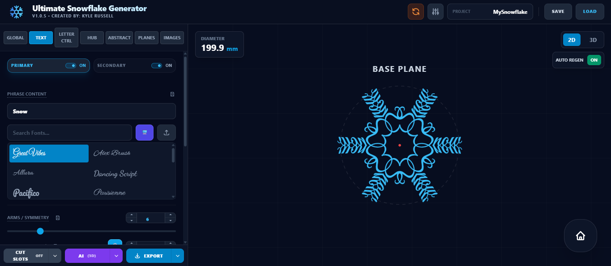
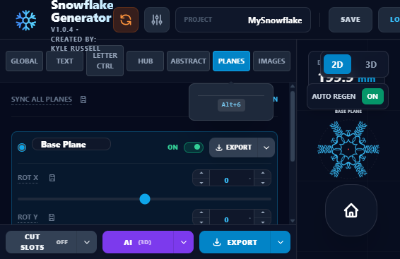
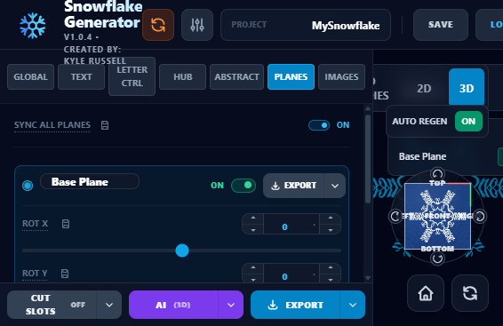
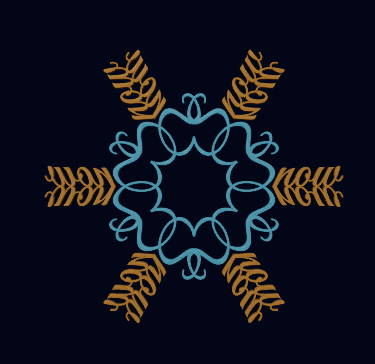
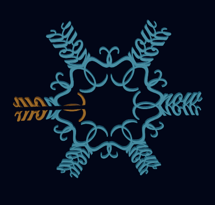
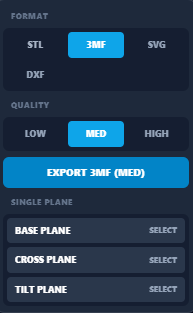

# Ultimate Snowflake Generator - Created by Kyle Russell

## Download
- Web app: [Open in your browser](https://kar883.github.io/Ultimate-Snowflake-Generator/)
- Windows installer: [Snowflake-Generator-Windows-Installer-1.2.0.exe](https://github.com/kar883/Ultimate-Snowflake-Generator/releases/download/v1.2.0/Snowflake-Generator-Windows-Installer-1.2.0.exe)
- Windows portable: [Snowflake-Generator-Windows-Portable-1.2.0.zip](https://github.com/kar883/Ultimate-Snowflake-Generator/releases/download/v1.2.0/Snowflake-Generator-Windows-Portable-1.2.0.zip)
- macOS installer: [Snowflake-Generator-macOS-Installer-1.2.0.dmg](https://github.com/kar883/Ultimate-Snowflake-Generator/releases/download/v1.2.0/Snowflake-Generator-macOS-Installer-1.2.0.dmg)
- macOS portable: [Snowflake-Generator-macOS-Portable-1.2.0.zip](https://github.com/kar883/Ultimate-Snowflake-Generator/releases/download/v1.2.0/Snowflake-Generator-macOS-Portable-1.2.0.zip)
- Linux portable: [Snowflake-Generator-Linux-Portable-1.2.0.AppImage](https://github.com/kar883/Ultimate-Snowflake-Generator/releases/download/v1.2.0/Snowflake-Generator-Linux-Portable-1.2.0.AppImage)
- Linux installer: [Snowflake-Generator-Linux-Installer-1.2.0.deb](https://github.com/kar883/Ultimate-Snowflake-Generator/releases/download/v1.2.0/Snowflake-Generator-Linux-Installer-1.2.0.deb)
- All release assets: [GitHub Releases](https://github.com/kar883/Ultimate-Snowflake-Generator/releases)

## Finished product examples

These proof-of-concept prints show assembled snowflakes created with the generator.

The web edition runs in your browser; your projects and preferences remain in that browser unless you export or share them. No account or app-hosted project storage is required.

### Windows security warning
The installer isn't code-signed, so Windows SmartScreen may show "Windows protected your PC" when you run it. This is expected for unsigned apps. To continue, click **More info**, then **Run anyway**. You can review the source code in this repository, or use the Windows ZIP version if you prefer not to run an installer.

Inspired by [Jexom's OpenSCAD snowflake](https://www.thingiverse.com/thing:2702278), I wanted to explore what could be done beyond its limits. Design 2D and 3D snowflakes from text, hubs, abstracts, SVG artwork, and multiple interlocking planes, then export them for 3D printing or vector workflows.

## Getting Started
- Download the installer or portable package for your operating system from the links above.
- For system-font access in a browser, use Chrome or Edge 103+ in a secure context (HTTPS or localhost). The system font picker may not be available in other browsers.
- AI-powered suggestions require an internet connection and a Gemini API key. Open **Settings & Shortcuts → API Key** in the app to add your key. It is stored in the browser's local storage and sent directly to Google when AI features are used; it is not sent to this app's server. Avoid saving it on shared devices or including it in shared project files.

## What You Can Do
- Create designs/snowflakes from repeating text, per-letter adjustments, hubs, oscillating outlines, abstract patterns and fractals, and imported SVG artwork. SVG artwork can be repeated radially or placed once in the center.
- Build one-, two-, or three-plane designs using Base, Cross, and Tilt planes. Choose whether edits apply to all planes or only the active plane.
- Cut assembly slots in 2-plane or 3-plane mode. Optional slot bridges can help keep pieces connected along the slot wherever it meets the design; they can be disabled. **Slots work best with even arm counts.** With an odd number of arms, the planes may not interlock or remain connected as reliably; the app warns when you enable slots for an odd-arm design.
- Add a hanging ring to any plane from the 2D preview. Toggle it on for the active plane, adjust its size using the inner/outer diameter readout in mm, and drag the green ring into position; it is included in that plane’s 3D extrusion and exports.
- Preview designs in 2D and 3D, inspect disconnected bodies, and adjust global geometry and appearance settings.
- Export combined or individual planes as STL or 3MF, batch-export planes, and export 2D artwork as SVG or DXF. Selecting multiple planes for STL creates separate files; selecting multiple planes for 3MF creates one file with the planes laid flat side by side. Save and load project JSON files.
- Automatic export estimation (file size, triangle count, export time) and warnings for potential issues (disconnected bodies).

## Assembly

Test-fit the printed planes before applying adhesive. For a three-plane snowflake, assemble the **Base** plane first, then slide in the **Cross** plane, followed by the **Tilt** plane. Align each plane with its matching slots and press the pieces together gently; do not force a misaligned joint.

Assembly order pictures will be added here in a future update.

If the fit is a little loose, a few drops of super glue at the joints can hold the assembled snowflake together nicely. Let the glue set fully before handling or hanging the finished piece. You can also adjust the slot tolerance in the **Planes** tab and re-export the planes for a tighter or looser fit.

## Tutorials
Use the **Settings** button in the app header to open the basic or advanced getting-started tutorial. The advanced walkthrough explains the options in the control-panel tabs and key app settings.

## Removing Floating Body Segments
1. Switch to **3D** and select **ID Bodies**. Disconnected segments are highlighted in orange; the body with the largest surface area on each plane remains unhighlighted.
2. Click a highlighted segment to remove it individually, or choose **Remove all highlighted bodies** to remove them from all visible planes. Check the design first: some disconnected pieces may be intentional.
3. Export the 3D model as usual. Removed segments are excluded from 3D exports; if an export resolution cannot uniquely match a removed segment, the export stops rather than removing the wrong piece.

Removal affects only the current generated 3D model, not the 2D design or saved project settings. Regenerating the model restores the segments. A disconnected-body warning does not necessarily mean slots caused the separation.

## Saving Projects and Defaults
- Use **Save** and **Load** in the app header to save a design to a project JSON file and reopen it later.
- To reuse the current configuration when starting the app, choose **Save Startup Defaults** in **Settings & Shortcuts → Settings**. This is separate from saving a project file. Slot and enabled-plane startup settings can also be saved from their controls.
- Project files contain design settings and imported artwork data. They do not include your API key.

## Screenshots

### Text + Live Preview

### Plane Controls (Multi-Plane)

### 3D View

 - the app detects disconnected bodies and highlights them in orange to help identify potential issues before exporting/3d printing.

### Export Options

- Exporting in low quality is usually sufficient and faster. Higher quality is available but takes longer to export and files are significantly larger.

## Tips
- Start with simple text and 1 plane to get familiar, then explore more complex features.
- To add a hanging ring, switch to the 2D view, select the target plane, turn on **Hanging ring**, adjust the diameter slider, and drag the green ring onto the desired arm. The ring position is saved with the plane.
- Do most of your modeling in the 2D view to keep things fast and turn off "auto regenerate 3D" for faster editing. With auto regeneration off, use the 3D viewer's force-refresh button to rebuild from the latest settings, including slot and plane changes. Exports use the latest settings even if the 3D preview has not been refreshed. Turn auto regeneration back on for real-time updates.
- Use **ID Bodies** in the 3D preview to inspect disconnected bodies before exporting for 3D printing. Click an orange body to remove it, or remove all highlighted bodies on visible planes; the body with the largest surface area on each plane is retained. Removals apply to 3D exports for the current generated design, not the 2D design or saved project, and are reset when the model is regenerated. Export stops if a removed body cannot be uniquely matched at the chosen resolution. A connectivity warning does not necessarily mean slots caused the separation.
- Fillets and chamfers on existing model edges are retained when slots are cut. Newly cut slot edges remain sharp, with square ends to preserve mating clearance.
- If 3D generation fails, the last successful preview may be out of date. Dismiss the error to keep editing, or use its retry button to rebuild from the current settings. Check the preview and export before printing.

## Plane Sync Modes
- Sync All Planes ON (synchronous mode): text, hub, abstract, and image pattern changes are applied to all enabled planes together.
- Sync All Planes OFF (asynchronous mode): each plane keeps its own independent text/pattern settings, and only the active plane is edited when you change controls.
- In asynchronous mode, the active plane is visually emphasized in 2D and 3D previews so you can quickly see which plane you are editing.

## Share Your Designs
Share a project JSON file or a picture of your design by using GitHub's web upload page for the Examples folder:

[Upload a design to Examples](https://github.com/kar883/Ultimate-Snowflake-Generator/upload/main/Examples)

Choose **Add file → Upload files**, select your file, and follow GitHub's prompts to commit it or create a pull request. If you do not have write access, GitHub will guide you through proposing the file from a fork. Please do not include API keys or other private information.
   
## License

This project is licensed under
[Creative Commons Attribution-NonCommercial 4.0 International (CC BY-NC 4.0)](https://creativecommons.org/licenses/by-nc/4.0/).
