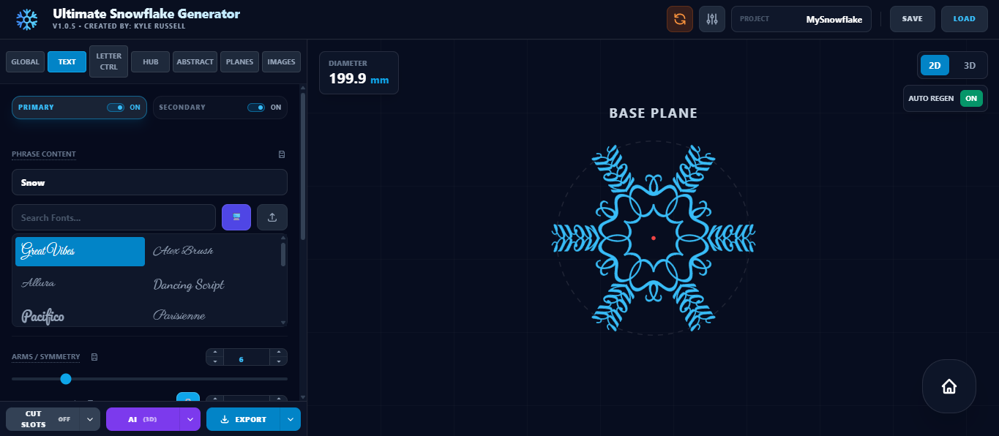
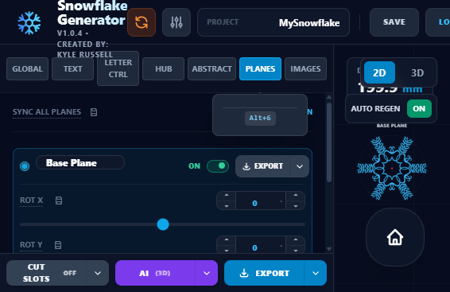
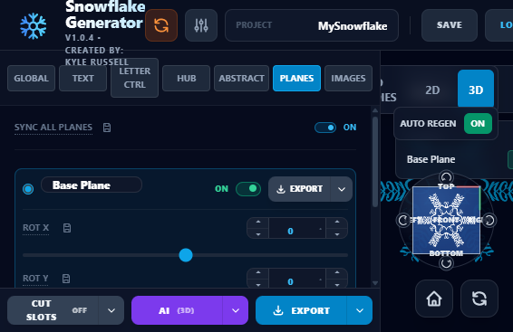
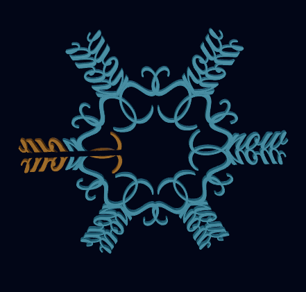
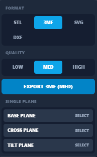

# Ultimate Snowflake Generator - Created by Kyle Russell

## Download
- Windows Installer: [Snowflake.Generator.Setup.1.1.4.exe](https://github.com/kar883/Ultimate-Snowflake-Generator/releases/download/v1.1.4/Snowflake.Generator.Setup.1.1.4.exe)
- Windows ZIP: [Snowflake.Generator-1.1.4-win.zip](https://github.com/kar883/Ultimate-Snowflake-Generator/releases/download/v1.1.4/Snowflake.Generator-1.1.4-win.zip)
- macOS DMG: [Snowflake.Generator-1.1.4-arm64.dmg](https://github.com/kar883/Ultimate-Snowflake-Generator/releases/download/v1.1.4/Snowflake.Generator-1.1.4-arm64.dmg)
- macOS ZIP: [Snowflake.Generator-1.1.4-arm64-mac.zip](https://github.com/kar883/Ultimate-Snowflake-Generator/releases/download/v1.1.4/Snowflake.Generator-1.1.4-arm64-mac.zip)
- Linux AppImage: [Snowflake.Generator-1.1.4.AppImage](https://github.com/kar883/Ultimate-Snowflake-Generator/releases/download/v1.1.4/Snowflake.Generator-1.1.4.AppImage)
- Linux Debian/Ubuntu package: [snowflake-generator_1.1.4_amd64.deb](https://github.com/kar883/Ultimate-Snowflake-Generator/releases/download/v1.1.4/snowflake-generator_1.1.4_amd64.deb)
- All release assets: [GitHub Releases](https://github.com/kar883/Ultimate-Snowflake-Generator/releases)

The macOS downloads are for Apple Silicon (ARM64).

### Windows security warning
The installer isn't code-signed, so Windows SmartScreen may show "Windows protected your PC" when you run it. This is expected for unsigned apps. To continue, click **More info**, then **Run anyway**. You can review the source code in this repository, or use the Windows ZIP version if you prefer not to run an installer.

Inspired by [Jexom's OpenSCAD snowflake](https://www.thingiverse.com/thing:2702278), I wanted to explore what could be done beyond its limits. Design 2D and 3D snowflakes from text, hubs, abstracts, SVG artwork, and multiple interlocking planes, then export them for 3D printing or vector workflows.

## Getting Started
- Download the installer or portable package for your operating system from the links above.
- For system-font access in a browser, use Chrome or Edge 103+ in a secure context (HTTPS or localhost). The system font picker may not be available in other browsers.
- AI-powered suggestions require an internet connection and a Gemini API key. Open **Settings & Shortcuts → API Key** in the app to add your key. It is stored locally in the app; do not share it or upload it with a project.

## What You Can Do
- Create designs/snowflakes from repeating text, per-letter adjustments, hubs, oscillating outlines, abstract patterns and fractals, and imported SVG artwork. SVG artwork can be repeated radially or placed once in the center.
- Build one-, two-, or three-plane designs using Base, Cross, and Tilt planes. Choose whether edits apply to all planes or only the active plane.
- Cut assembly slots in 2-plane or 3-plane mode. Optional slot bridges can help keep pieces connected; they can be disabled. **Slots work best with even arm counts.** With an odd number of arms, the planes may not interlock or remain connected as reliably; the app warns when you enable slots for an odd-arm design.
- Preview designs in 2D and 3D, inspect disconnected bodies, and adjust global geometry and appearance settings.
- Export combined or individual planes as STL or 3MF, batch-export planes, and export 2D artwork as SVG or DXF. Save and load project JSON files.
- Automatic export estimation (file size, triangle count, export time) and warnings for potential issues (disconnected bodies).

## Tutorials
Use the **Settings** button in the app header to open the basic or advanced getting-started tutorial. The advanced walkthrough explains the options in the control-panel tabs and key app settings.

## Saving Projects and Defaults
- Use **Save** and **Load** in the app header to save a design to a project JSON file and reopen it later.
- To reuse the current configuration when starting the app, choose **Save Startup Defaults** in **Settings & Shortcuts → Settings**. This is separate from saving a project file. Slot and enabled-plane startup settings can also be saved from their controls.
- Project files contain design settings and imported artwork data. They do not include your API key.

## Screenshots

### Text + Live Preview

### Plane Controls (Multi-Plane)

### 3D View

 - the app detects disconnected bodies and highlights them in orange to help identify potential issues before exporting/3d printing.

### Export Options

- Exporting in low quality is usually sufficient and faster. Higher quality is available but takes longer to export and files are significantly larger.

## Tips
- Start with simple text and 1 plane to get familiar, then explore more complex features.
- Do most of your modeling in the 2D view to keep things fast and turn off "auto regenerate 3D" for faster editing. With auto regeneration off, use the 3D viewer's force-refresh button to rebuild from the latest settings, including slot and plane changes. Turn auto regeneration back on for real-time updates.
- Use **ID Bodies** in the 3D preview to inspect disconnected bodies before exporting for 3D printing. A connectivity warning does not necessarily mean slots caused the separation.
- Fillets and chamfers on existing model edges are retained when slots are cut. Newly cut slot edges remain sharp to preserve the mating clearance.
- If 3D generation fails, the last successful preview may be out of date. Dismiss the error to keep editing, or use its retry button to rebuild from the current settings. Check the preview and export before printing.

## Plane Sync Modes
- Sync All Planes ON (synchronous mode): text, hub, abstract, and image pattern changes are applied to all enabled planes together.
- Sync All Planes OFF (asynchronous mode): each plane keeps its own independent text/pattern settings, and only the active plane is edited when you change controls.
- In asynchronous mode, the active plane is visually emphasized in 2D and 3D previews so you can quickly see which plane you are editing.

## Share Your Designs
Share a project JSON file or a picture of your design by using GitHub's web upload page for the Examples folder:

[Upload a design to Examples](https://github.com/kar883/Ultimate-Snowflake-Generator/upload/main/Examples)

Choose **Add file → Upload files**, select your file, and follow GitHub's prompts to commit it or create a pull request. If you do not have write access, GitHub will guide you through proposing the file from a fork. Please do not include API keys or other private information.
   
## License

This project is licensed under
[Creative Commons Attribution-NonCommercial 4.0 International (CC BY-NC 4.0)](https://creativecommons.org/licenses/by-nc/4.0/).
